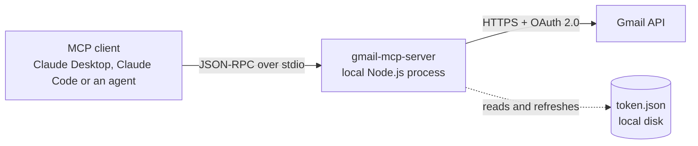

# Gmail MCP Server

Least-privilege Gmail access for AI agents over the Model Context Protocol: search, read and draft replies. It never sends.

[](LICENSE)


## Contents

- [What it is](#what-it-is)
- [Architecture](#architecture)
- [Tools](#tools)
- [Security model](#security-model)
- [Setup](#setup)
- [Connect to Claude](#connect-to-claude)
- [Triage demo](#triage-demo)
- [Design decisions](#design-decisions)
- [Limitations](#limitations)
- [From demo to production](#from-demo-to-production)
- [Troubleshooting](#troubleshooting)
- [Development](#development)
- [Tests](#tests)
- [License](#license)

## What it is

A small Model Context Protocol (MCP) server, written in TypeScript, that gives an AI agent least-privilege access to one Gmail inbox. The agent can search mail, read messages and threads as clean plain text, and save draft replies in the correct thread. It cannot send, delete, label or archive mail, or change settings. The server runs locally as a stdio subprocess of the MCP client. It uses OAuth credentials that the mailbox owner creates and keeps, and it has no backend, database or third-party service in between.

## Architecture



- The client starts the server as a child process and talks to it over stdin and stdout. No network port is opened.
- The server calls the Gmail REST API directly with the user's OAuth token, which never leaves the machine.
- Every Gmail response is parsed and rendered as plain text before it reaches the model.

| Module | Responsibility |
|---|---|
| `src/index.ts` | Entry point: stdio transport, protection of the stdout stream |
| `src/server.ts` | `McpServer` setup, tool registration, zod input schemas, error-to-result mapping |
| `src/gmail/client.ts` | Authenticated Gmail client, token persistence and refresh, retry policy |
| `src/gmail/parse.ts` | MIME tree walking, base64url and charset decoding, HTML-to-text, output formatting |
| `src/gmail/draft.ts` | RFC 2822 reply builder: recipients, subject, threading headers, encoding |
| `src/gmail/errors.ts` | Classification of Gmail API errors into readable messages |
| `src/auth.ts` | One-time OAuth sign-in (`npm run auth`) |
| `src/config.ts` | Scopes, environment variables and file paths |

## Tools

| Tool | What it does | Read-only |
|---|---|---|
| `search_emails` | Searches the mailbox with Gmail query syntax and returns a summary per message | Yes |
| `get_email` | Reads one message: headers, plain-text body, attachment metadata | Yes |
| `get_thread` | Reads every message in a thread, oldest first | Yes |
| `create_draft_reply` | Saves a plain-text reply as a draft in the original thread. Never sends. | No (creates drafts only) |

All inputs are validated with zod before any Gmail call. Invalid input returns a validation error to the model; Gmail is never called with it. Each tool declares MCP annotations: `readOnlyHint: true` on the three read tools, and `readOnlyHint: false, destructiveHint: false, idempotentHint: false` on `create_draft_reply`.

### `search_emails`

| Parameter | Type | Default | Constraints |
|---|---|---|---|
| `query` | string | `in:inbox` | Gmail search syntax, 1 to 500 characters |
| `max_results` | integer | `10` | 1 to 25 |

Returns id, threadId, from, to, subject, date, snippet and labels for each match, newest first.

```text
1 message(s) matching "in:inbox":

1. Ticket #123
   id: m-meta
   threadId: t-200
   from: Support <support@vendor.example>
   to: me@example.com
   date: Sun, 1 Nov 2026 18:00:00 +0000
   labels: INBOX, CATEGORY_UPDATES
   snippet: We've received your request & will reply soon
```

### `get_email`

| Parameter | Type | Constraints |
|---|---|---|
| `message_id` | string | Gmail id: letters, digits, `-` or `_`, up to 64 characters |

Returns From, To, Cc, Subject, Date and Message-ID; the body as plain text; and each attachment's name, type and size. Attachment content is never downloaded.

```text
Message ID: m-nested
Thread ID: t-100
From: Alice Example <alice@example.com>
To: me@example.com
Cc: Carol <carol@example.com>
Subject: Quarterly invoice
Date: Mon, 2 Nov 2026 09:15:00 +0000
Message-ID header: <CAF1234@mail.example.com>
Attachments (metadata only):
- logo.png (image/png, 2.0 KB)
- invoice-2026-11.pdf (application/pdf, 179.2 KB)

See the attached invoice. Total: 1 200 €. 👍
```

Body extraction:

- Walks the full MIME tree, including nested `multipart/*` parts.
- Decodes base64url and the declared charset (for example ISO-8859-1).
- Prefers `text/plain`. Falls back to `text/html`, converted with a light tag strip.
- Truncates bodies over 20,000 characters and says so in the output.

### `get_thread`

| Parameter | Type | Constraints |
|---|---|---|
| `thread_id` | string | Gmail id, same rules as `message_id` |

Returns every message in the thread, oldest first, each in the `get_email` format.

### `create_draft_reply`

| Parameter | Type | Constraints |
|---|---|---|
| `message_id` | string | The message being replied to |
| `body` | string | Plain text, 1 to 50,000 characters, not whitespace-only. Kept exactly as written. |

The draft is built as follows:

| Field | Rule |
|---|---|
| Recipient | The original's `Reply-To` if present, otherwise `From`. If the original is the user's own sent message, its recipients instead. Sender only, never reply-all. |
| Subject | Prefixed with `Re: `, unless it already starts with `Re:` in any case |
| Threading | `threadId`, `In-Reply-To` set to the original Message-ID, and `References` set to the original chain plus that Message-ID |
| Encoding | RFC 2047 for non-ASCII subjects and display names; UTF-8 body with base64 transfer encoding; `raw` sent as base64url |

```text
Draft reply created. It has not been sent.
Draft ID: <id assigned by Gmail>
Thread ID: 18c2e9f8a7b6c5d4
To: Billing Team <billing@example.com>
Subject: Re: Invoice #4711 follow-up
Review and send it from Gmail Drafts.
```

## Security model

### Scopes

The server requests exactly two OAuth scopes:

| Scope | Used for |
|---|---|
| `https://www.googleapis.com/auth/gmail.readonly` | Searching and reading messages and threads |
| `https://www.googleapis.com/auth/gmail.compose` | Creating drafts |

Gmail has no scope that allows creating drafts without also allowing sending: `gmail.compose` permits both. Least privilege is therefore enforced in two layers:

1. **The narrowest scopes Gmail offers for this feature set.** No `gmail.modify` and no full `mail.google.com` access, so the token cannot delete mail, change labels or change settings.
2. **No send tool.** The only write operation in the code is `users.drafts.create`, and a person reviews and sends each draft from Gmail.

The second layer is a property of this code, not of the token. Anyone who obtains `token.json` could send mail as the user, so treat it like a password.

### Controls

| Risk | Control |
|---|---|
| The agent sends mail in the user's name | No send tool. Replies are saved as drafts for a person to review and send. |
| The agent deletes or alters mail | No `gmail.modify` or full-access scope, and no delete, label or archive tools |
| Prompt injection through email content | Email is untrusted input to the model. With this tool set, the worst outcome is an unwanted draft, never a sent or deleted message. |
| Header injection through a crafted original | CR/LF is stripped from every header value copied from the original message, so `Hi\r\nBcc: attacker@example.com` stays a harmless subject |
| Malicious attachments | Attachment content is never downloaded; only name, type and size are returned |
| Token leakage | `credentials.json`, `token.json` and `.env` are git-ignored. The token is written atomically with mode `0600` on POSIX systems. Raw Google client errors, which include the `Authorization` header, are never logged or returned. |
| Sensitive data in logs | Logs contain the tool name, outcome and duration only, never queries, addresses or message content |
| Third-party data exposure | Local stdio process. The mailbox owner creates the OAuth client in their own Google Cloud project, and no intermediary service holds tokens. |

Access can be revoked at any time at [myaccount.google.com/permissions](https://myaccount.google.com/permissions).

## Setup

### Requirements

- Node.js 22.12 or later
- A Google account
- A Google Cloud project you control (free)

### 1. Create the OAuth client in Google Cloud

1. In [Google Cloud Console](https://console.cloud.google.com/), create a project, or select an existing one.
2. Enable the Gmail API: **APIs & Services > Library > Gmail API > Enable**.
3. Configure the OAuth consent screen (**Google Auth Platform**):
   - User type: External.
   - Publishing status: Testing.
   - Add the Gmail address you will use under **Test users**.
4. Create credentials: **Clients > Create client**, application type **Desktop app**.
5. Download the client JSON and save it as `credentials.json` in the project root.

> **Note:** while the project is in Testing status, Google expires refresh tokens after 7 days, and the tools then ask you to run `npm run auth` again. Removing that limit requires publishing the app. Both scopes are classed as restricted by Google, so a public app needs Google's verification, which can include a third-party security assessment. For a single internal mailbox, Testing status or a Google Workspace internal app is the practical option.

### 2. Install, sign in and build

```bash
git clone https://github.com/AlexisG1993/mcp_gmail.git
cd mcp_gmail
npm install
npm run auth     # builds, opens the browser, saves token.json
npm run build
```

`npm run auth`:

- uses the OAuth loopback flow with PKCE and a `state` check;
- verifies that both scopes were granted;
- makes one read-only call to confirm access, and prints the signed-in address.

### Configuration

| Variable | Default | Purpose |
|---|---|---|
| `GMAIL_CREDENTIALS_PATH` | `<project>/credentials.json` | OAuth client file downloaded from Google Cloud |
| `GMAIL_TOKEN_PATH` | `<project>/token.json` | Saved token, written by `npm run auth` and refreshed automatically |

Relative paths are resolved against the project root, not the working directory, because MCP clients start servers from arbitrary directories.

## Connect to Claude

Use the absolute path to `dist/index.js`. On Windows, forward slashes work (`C:/Users/you/mcp_gmail/dist/index.js`).

### Claude Desktop

Edit `claude_desktop_config.json`:

| OS | Location |
|---|---|
| macOS | `~/Library/Application Support/Claude/claude_desktop_config.json` |
| Windows | `%APPDATA%\Claude\claude_desktop_config.json` |

```json
{
  "mcpServers": {
    "gmail": {
      "command": "node",
      "args": ["/absolute/path/to/mcp_gmail/dist/index.js"]
    }
  }
}
```

Add an `"env"` object with `GMAIL_CREDENTIALS_PATH` and `GMAIL_TOKEN_PATH` only if the files are not in the project root. Restart Claude Desktop afterwards.

### Claude Code

```bash
claude mcp add --transport stdio gmail -- node /absolute/path/to/mcp_gmail/dist/index.js
```

To keep the files elsewhere, add `--env GMAIL_TOKEN_PATH=/secure/path/token.json` (and likewise for credentials) before the server name.

## Triage demo

`examples/triage-demo.ts` shows the server used by an agent pipeline instead of a chat client.

1. It starts the server over stdio with the official MCP client.
2. It reads the 10 most recent inbox emails through `search_emails` and `get_email`.
3. It asks Claude (`claude-opus-5-5`) to classify each one, using structured JSON output validated against a zod schema:
   - type: `customer`, `vendor`, `admin` or `other`
   - priority: `high`, `normal` or `low`
4. It prints a table with a one-line reason for each classification.

```bash
export ANTHROPIC_API_KEY=...       # PowerShell: $env:ANTHROPIC_API_KEY = "..."
npm run demo
```

The demo calls only read tools. It passes the server only the Gmail path variables, never the API key. It also tells the model to treat email content as untrusted data, never as instructions.

## Design decisions

**stdio transport.** The server is a child process of the MCP client on the user's machine. It opens no network port, so there is no listener to authenticate or expose. The OAuth token stays on the same machine as the user. stdout carries only the MCP protocol: all logging goes to stderr, and `console.log` is redirected to stderr so a dependency cannot corrupt the stream.

**Plain-text output.** Tools return labelled plain text, not raw Gmail JSON. Models read it reliably, it costs far fewer tokens than the API's nested MIME structure, and every tool presents emails in the same shape. Decoding, charset handling, HTML stripping and truncation happen once, in tested code, instead of being left to the model.

**Drafts instead of sending.** Sending is irreversible and acts in the user's name. A draft keeps a person in the loop at the one step where a mistake is costly, while still doing the bulk of the work.

**Failure handling.**

- Gmail errors become tool results with `isError: true` and a specific message, never a crash. Examples: not found, rate limited, Gmail API not enabled, sign-in expired.
- 429s, 403 rate-limit errors and 5xx responses are retried with exponential backoff and jitter, at most 3 attempts. `Retry-After` is honoured, capped at 8 seconds.
- The Google client library's own retry is switched off, so this is the only retry policy. Left on, a single failing call can make 12 HTTP requests.
- Creating a draft is not retried on 5xx, because Gmail may already have saved it and a retry would create a duplicate.
- An expired or revoked sign-in is detected, and the cached client is dropped. Running `npm run auth` then takes effect without restarting the server.

**Minimal dependencies.**

- Runtime: `@modelcontextprotocol/server` (MCP TypeScript SDK v2), `googleapis`, `google-auth-library` and `zod`.
- No HTML parsing library, no framework, no database.

## Limitations

- **One mailbox per server instance.** Each instance runs with one token; multiple mailboxes need multiple configured instances.
- **Plain-text drafts only.** Drafts have no HTML formatting and no attachments, and replies go to the sender only (no reply-all).
- **No attachment content.** Attachments are reported by name, type and size only, by design.
- **Bounded output.** Bodies are truncated at 20,000 characters, and search returns at most 25 results with no pagination.
- **Light HTML conversion.** It suits typical email but is not a renderer; complex layouts lose some structure.
- **Testing-mode tokens.** Unpublished Google Cloud projects expire refresh tokens after 7 days.

## From demo to production

This server lets an agent work an inbox on request. A production triage system that processes every incoming email unattended needs more:

| Capability | Purpose |
|---|---|
| **Push notifications** | Call `users.watch` to have Gmail publish mailbox changes to a Cloud Pub/Sub topic, processed by a subscriber, instead of polling. |
| **historyId checkpoints** | Each notification carries a `historyId`. Persist the last processed one and fetch changes since then with `users.history.list`, so nothing is missed across restarts. If the stored id is too old (Gmail returns 404), fall back to a full sync. |
| **Idempotent ticket ledger** | Pub/Sub delivers at least once. Record each Gmail message id before acting on it, so a redelivered notification never creates a second ticket or draft. |
| **Dead-letter queue** | Messages that keep failing (parse errors, model errors, downstream outages) move to a DLQ after a bounded number of attempts, for inspection and replay, without blocking the stream. |
| **Daily reconciliation sweep** | A scheduled job compares recent inbox messages with the ledger and catches anything a dropped notification or outage missed. |
| **Watch renewal** | A watch expires after 7 days. Renew it on a schedule; Google recommends daily, which leaves a wide safety margin. |
| **Deployment** | Run as a service with secrets in a secret manager. For a Google Workspace domain, use a service account with domain-wide delegation instead of a personal OAuth token. Add metrics and alerting on queue depth, error rate and watch expiry. |

## Troubleshooting

| Message or symptom | Cause and fix |
|---|---|
| `OAuth client file not found at ...` | `credentials.json` is missing. Download the Desktop app client from Google Cloud and save it in the project root, or set `GMAIL_CREDENTIALS_PATH`. |
| `... is not a Desktop app OAuth client file` | The client was created as a Web application. Create a **Desktop app** client instead. |
| Google shows "Access blocked" or "has not completed the Google verification process" | Your address is not a test user. Add it under **Google Auth Platform > Audience > Test users**. |
| `Sign-in did not grant all required permissions` | A permission was unticked on the consent screen. Run `npm run auth` again and leave every Gmail permission ticked. |
| `No saved Gmail token found at ...` | Sign-in has not been done for this path. Run `npm run auth`. |
| `The saved Gmail sign-in has expired or was revoked.` | Usually the 7-day Testing-mode expiry. Run `npm run auth`; no restart is needed. |
| `The Gmail API is not enabled for this Google Cloud project.` | Enable the Gmail API under **APIs & Services > Library**. |
| `Gmail rate limit reached, even after retrying.` | Gmail is throttling the account. Wait a minute and retry. |
| The client shows no Gmail tools | Check that the config path points to `dist/index.js`, that `npm run build` has been run, and restart the client. Server logs go to stderr, which Claude Desktop writes to its MCP log files. |

## Development

| Script | What it does |
|---|---|
| `npm run build` | Compiles TypeScript to `dist/` |
| `npm start` | Runs the server on stdio (normally started by the MCP client instead) |
| `npm run auth` | Builds, then runs the one-time OAuth sign-in |
| `npm test` | Runs the test suite |
| `npm run typecheck` | Strict type-check of source, tests and examples |
| `npm run demo` | Builds, then runs the triage demo |

```text
src/
  index.ts           entry point, stdio transport
  server.ts          McpServer setup and tool registration
  auth.ts            one-time OAuth flow (npm run auth)
  config.ts          scopes, env vars and paths
  log.ts             stderr logger
  gmail/
    client.ts        authenticated Gmail client, retries
    parse.ts         MIME and body parsing, output formatting
    draft.ts         RFC 2822 reply builder
    errors.ts        Gmail error classification
tests/
  fixtures/          Gmail-shaped JSON responses
  parse.test.ts      MIME parsing
  draft.test.ts      reply building
  errors.test.ts     error handling and retries
  server.test.ts     input validation and tool results
examples/
  triage-demo.ts     MCP client + Claude API classification
```

## Tests

```bash
npm test            # vitest, no network access
npm run typecheck   # strict TypeScript, source, tests and examples
```

The tests run without network access, using small JSON fixtures shaped like real Gmail API responses.

| Area | Coverage |
|---|---|
| MIME parsing | Plain-only, HTML-only, `multipart/alternative`, nested multipart with attachments, attached `.eml` files, non-UTF-8 charsets, base64url edge cases (padding, URL-safe alphabet, multi-byte characters), truncation at the 20,000-character boundary |
| Draft building | Recipient selection, `Re:` handling, `In-Reply-To` and `References`, `threadId`, header-injection attempts, RFC 2047 encoding of non-ASCII subjects and names, line-length limits, base64url output |
| Reliability | Error classification and messages, auth-failure detection, retry behaviour (what is retried, the attempt cap, backoff ranges, the `Retry-After` cap) |
| Input validation | Defaults, bounds and rejection cases for every tool's schema, and an assertion that nothing is ever written to stdout |

## License

MIT. See [LICENSE](LICENSE).
