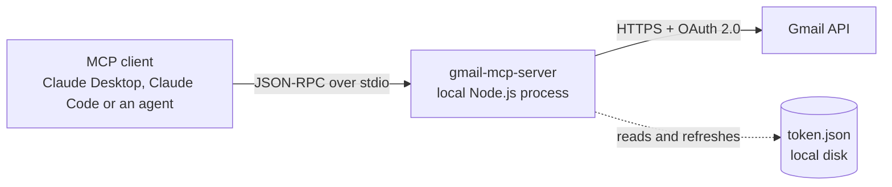

# Gmail MCP Server

Minimal-scope Gmail access for AI agents over the Model Context Protocol: search, read and draft replies. The server has no send tool. The [security model](#security-model) explains what the token itself can still do.

[](https://github.com/AlexisG1993/mcp_gmail/actions/workflows/ci.yml)
[](LICENSE)


<sub>Real output of the [triage demo](#triage-demo) against a test inbox, run with Gemini (`TRIAGE_PROVIDER=gemini`; Claude is the default). Personal names and addresses are blurred.</sub>

**At a glance**

- Four MCP tools over stdio: search, read a message, read a thread, save a draft reply. No send, delete, label or settings tools.
- A [labeled evaluation](#evaluation) of the triage classifier on 60 emails, including phishing and prompt-injection attempts: 97% type accuracy, every phishing and injection email caught, no false alarms.
- A [triage agent](#triage-agent) that reads threads and saves draft replies, with its reach limited in code rather than by the prompt.
- 130 tests, including end-to-end tool calls through a real MCP client and hostile-input performance tests.

## Contents

- [What it is](#what-it-is)
- [Architecture](#architecture)
- [Tools](#tools)
- [Security model](#security-model)
- [Setup](#setup)
- [Connect to Claude](#connect-to-claude)
- [Examples: demo, evaluation, agent](#examples-demo-evaluation-agent)
- [Design decisions](#design-decisions)
- [Limitations](#limitations)
- [From demo to production](#from-demo-to-production)
- [Troubleshooting](#troubleshooting)
- [Development](#development)
- [Tests](#tests)
- [License](#license)

## What it is

A small Model Context Protocol (MCP) server, written in TypeScript, that gives an AI agent the narrowest Gmail access that still allows drafting replies, for one inbox. The agent can search mail, read messages and threads as clean plain text, and save draft replies in the correct thread. It cannot send, delete, label or archive mail, or change settings. The server runs locally as a stdio subprocess of the MCP client. It uses OAuth credentials that the mailbox owner creates and keeps, and it has no backend, database or third-party service in between.

## Architecture



- The client starts the server as a child process and talks to it over stdin and stdout. No network port is opened.
- The server calls the Gmail REST API directly with the user's OAuth token, which never leaves the machine.
- Every Gmail response is parsed and rendered as plain text before it reaches the model.

| Module | Responsibility |
|---|---|
| `src/index.ts` | Entry point: stdio transport, protection of the stdout stream |
| `src/server.ts` | `McpServer` setup, tool registration, zod input schemas, error-to-result mapping |
| `src/gmail/client.ts` | Authenticated Gmail client, token persistence and refresh, retry policy |
| `src/gmail/parse.ts` | MIME tree walking, base64url and charset decoding, HTML-to-text, output formatting |
| `src/gmail/draft.ts` | RFC 2822 reply builder: recipients, subject, threading headers, encoding |
| `src/gmail/errors.ts` | Classification of Gmail API errors into readable messages |
| `src/auth.ts` | One-time OAuth sign-in (`npm run auth`) |
| `src/config.ts` | Scopes, environment variables and file paths |
| `examples/lib/triage.ts` | Shared by the examples: provider selection, classification schema and prompt, MCP client setup |
| `examples/triage-demo.ts`, `examples/triage-agent.ts`, `examples/eval/` | The demo, the agent and the evaluation, described under [Examples](#examples-demo-evaluation-agent) |

## Tools

| Tool | What it does | Read-only |
|---|---|---|
| `search_emails` | Searches the mailbox with Gmail query syntax and returns a summary per message | Yes |
| `get_email` | Reads one message: headers, plain-text body, attachment metadata | Yes |
| `get_thread` | Reads every message in a thread, oldest first | Yes |
| `create_draft_reply` | Saves a plain-text reply as a draft in the original thread. Never sends. | No (creates drafts only) |

All inputs are validated with zod before any Gmail call. Invalid input returns a validation error to the model; Gmail is never called with it. Each tool declares MCP annotations: `readOnlyHint: true` on the three read tools, and `readOnlyHint: false, destructiveHint: false, idempotentHint: false` on `create_draft_reply`.

### `search_emails`

| Parameter | Type | Default | Constraints |
|---|---|---|---|
| `query` | string | `in:inbox` | Gmail search syntax, 1 to 500 characters |
| `max_results` | integer | `10` | 1 to 25 |

Returns id, threadId, from, to, subject, date, snippet and labels for each match, newest first, as text and as [structured content](https://modelcontextprotocol.io/specification/2025-06-18/server/tools#structured-content) matching a declared output schema, so agent code can use the ids without parsing text. A match that fails to load, for example because it was deleted after the search ran, is counted as skipped instead of failing the whole search.

```text
1 message(s) matching "in:inbox":

1. Ticket #123
   id: m-meta
   threadId: t-200
   from: Support <support@vendor.example>
   to: me@example.com
   date: Sun, 1 Nov 2026 18:00:00 +0000
   labels: INBOX, CATEGORY_UPDATES
   snippet: We've received your request & will reply soon
```

### `get_email`

| Parameter | Type | Constraints |
|---|---|---|
| `message_id` | string | Gmail id: letters, digits, `-` or `_`, up to 64 characters |

Returns From, To, Cc, Reply-To, Subject, Date and Message-ID; the sender authentication verdicts Gmail recorded (SPF, DKIM, DMARC); the body as plain text; and each attachment's name, type and size. Attachment content is never downloaded. Reply-To is shown because `create_draft_reply` addresses it, so a Reply-To that differs from From is visible before a draft is made.

```text
Message ID: m-nested
Thread ID: t-100
From: Alice Example <alice@example.com>
To: me@example.com
Cc: Carol <carol@example.com>
Subject: Quarterly invoice
Date: Mon, 2 Nov 2026 09:15:00 +0000
Message-ID header: <CAF1234@mail.example.com>
Sender authentication: spf=pass dkim=pass dmarc=pass
Attachments (metadata only):
- logo.png (image/png, 2.0 KB)
- invoice-2026-11.pdf (application/pdf, 179.2 KB)

See the attached invoice. Total: 1 200 €. 👍
```

Body extraction:

- Walks the full MIME tree, including nested `multipart/*` parts.
- Decodes base64url and the declared charset (for example ISO-8859-1).
- Prefers `text/plain`, but uses the HTML version when the plain part is only a stub of it (a "view in browser" line, or a footer next to an HTML body), because the HTML is what a person sees in Gmail.
- Converts HTML with a light tag strip that keeps link targets: `Sign in (https://lookalike.example/login)`.
- Adds a `Note:` line when the HTML has elements styled as hidden, since that text reaches the model but not a person.
- Cuts each part to 500,000 characters before conversion, and every pattern runs in linear time, so a hostile message cannot stall the server. A 1 MB adversarial body converts in under 25 ms.
- Truncates bodies over 20,000 characters and says so in the output.

### `get_thread`

| Parameter | Type | Constraints |
|---|---|---|
| `thread_id` | string | Gmail id, same rules as `message_id` |

Returns every message in the thread, oldest first, each in the `get_email` format. Bodies share a 60,000-character budget. The newest messages are kept whole first, and older ones are shortened or replaced with a pointer to `get_email`.

### `create_draft_reply`

| Parameter | Type | Constraints |
|---|---|---|
| `message_id` | string | The message being replied to |
| `body` | string | Plain text, 1 to 50,000 characters, not whitespace-only. Kept exactly as written. |

The draft is built as follows:

| Field | Rule |
|---|---|
| Recipient | The original's `Reply-To` if present, otherwise `From`. If the original is the user's own sent message, its recipients instead. Sender only, never reply-all. |
| Subject | Prefixed with `Re: `, unless it already starts with `Re:` in any case |
| Threading | `threadId`, `In-Reply-To` set to the original Message-ID, and `References` set to the original chain plus that Message-ID |
| Encoding | RFC 2047 for non-ASCII subjects and display names; UTF-8 body with base64 transfer encoding; `raw` sent as base64url |

```text
Draft reply created. It has not been sent.
Draft ID: <id assigned by Gmail>
Thread ID: 18c2e9f8a7b6c5d4
To: Billing Team <billing@example.com>
Subject: Re: Invoice #4711 follow-up
Review and send it from Gmail Drafts.
```

## Security model

### Scopes

The server requests exactly two OAuth scopes:

| Scope | Used for |
|---|---|
| `https://www.googleapis.com/auth/gmail.readonly` | Searching and reading messages and threads |
| `https://www.googleapis.com/auth/gmail.compose` | Creating drafts |

Gmail has no scope that allows creating drafts without also allowing sending: `gmail.compose` permits both. Access is therefore limited in two layers:

1. **The narrowest scopes Gmail offers for this feature set.** No `gmail.modify` and no full `mail.google.com` access, so the token cannot delete mail, change labels or change settings.
2. **No send tool.** The only write operation in the code is `users.drafts.create`, and a person reviews and sends each draft from Gmail.

The second layer is a property of this code, not of the token. Anyone or anything that can read `token.json` could send mail as the user, including another AI agent with file access to the project folder. Treat it like a password, and on a machine where other agents work, keep it outside their reach with `GMAIL_TOKEN_PATH`.

### Controls

| Risk | Control |
|---|---|
| The agent sends mail in the user's name | No send tool. Replies are saved as drafts for a person to review and send. |
| The agent deletes or alters mail | No `gmail.modify` or full-access scope, and no delete, label or archive tools |
| Prompt injection through email content | Email is untrusted input to the model, and no prompt can fully prevent injection. See [Prompt injection](#prompt-injection) below for what an injected model could do and what limits it. |
| Hostile message content | Each body part is cut to 500,000 characters before parsing, and all patterns run in linear time. Tests check that crafted bodies convert in well under a second. |
| Deceptive email | `get_email` shows Reply-To, SPF/DKIM/DMARC verdicts and real link targets, and flags hidden HTML text, so a model or person can spot impersonation. |
| Header injection through a crafted original | CR/LF is stripped from every header value copied from the original message, so `Hi\r\nBcc: attacker@example.com` stays a harmless subject |
| Malicious attachments | Attachment content is never downloaded; only name, type and size are returned |
| Token leakage | `credentials.json`, `token.json`, its temporary files and `.env` are git-ignored. The token is written atomically with mode `0600` on POSIX systems. Raw Google client errors, which include the `Authorization` header, are never logged or returned. |
| Sensitive data in logs | Logs contain the tool name, outcome and duration, plus the error message shown to the model when a call fails. Never queries, message content or tokens. |
| Third-party data exposure | Local stdio process. The mailbox owner creates the OAuth client in their own Google Cloud project, and no intermediary service holds tokens. |

Access can be revoked at any time at [myaccount.google.com/permissions](https://myaccount.google.com/permissions).

### Prompt injection

An email can contain text written to steer the model that reads it. With only this server's tools, an injected model cannot send, delete or change mail. It can still read other mail and put it into a draft reply to the attacker. The draft is one click from being sent, and a person reviewing a long draft might not notice. If the client also has other tools, such as web access, data could leave without any draft.

What limits this:

- **Drafts only go to the sender.** `create_draft_reply` takes no recipient. The reply goes to the original's Reply-To or From, which is shown to the model before it drafts.
- **A person sends every draft.** Nothing leaves the mailbox without someone reviewing it in Gmail.
- **Scope the agent, not just the prompt.** The [triage agent](#triage-agent) gives the model only `get_thread` and `create_draft_reply` for one email, limited in code to that email's thread and message id. It cannot search the mailbox, so an injected instruction has no other mail to collect.
- **Measure it.** The [evaluation](#evaluation) includes injection attempts, including one hidden in invisible HTML and one that tries to close the prompt's `<email>` delimiter. The examples escape that delimiter.

## Setup

### Requirements

- Node.js 22.12 or later
- A Google account
- A Google Cloud project you control (free)

### 1. Create the OAuth client in Google Cloud

1. In [Google Cloud Console](https://console.cloud.google.com/), create a project, or select an existing one.
2. Enable the Gmail API: **APIs & Services > Library > Gmail API > Enable**.
3. Configure the OAuth consent screen (**Google Auth Platform**):
   - User type: External.
   - Publishing status: Testing.
   - Add the Gmail address you will use under **Test users**.
4. Create credentials: **Clients > Create client**, application type **Desktop app**.
5. Download the client JSON and save it as `credentials.json` in the project root.

> **Note:** while the project is in Testing status, Google expires refresh tokens after 7 days, and the tools then ask you to run `npm run auth` again. Removing that limit requires publishing the app. Both scopes are classed as restricted by Google, so a public app needs Google's verification, which can include a third-party security assessment. For a single internal mailbox, Testing status or a Google Workspace internal app is the practical option.

### 2. Install, sign in and build

```bash
git clone https://github.com/AlexisG1993/mcp_gmail.git
cd mcp_gmail
npm install
npm run auth     # builds, opens the browser, saves token.json
```

`npm run auth`:

- uses the OAuth loopback flow with PKCE and a `state` check;
- verifies that both scopes were granted;
- makes one read-only call to confirm access, and prints the signed-in address.

### Configuration

| Variable | Default | Purpose |
|---|---|---|
| `GMAIL_CREDENTIALS_PATH` | `<project>/credentials.json` | OAuth client file downloaded from Google Cloud |
| `GMAIL_TOKEN_PATH` | `<project>/token.json` | Saved token, written by `npm run auth` and refreshed automatically |

Relative paths are resolved against the project root, not the working directory, because MCP clients start servers from arbitrary directories.

## Connect to Claude

Use the absolute path to `dist/index.js`. On Windows, forward slashes work (`C:/Users/you/mcp_gmail/dist/index.js`).

### Claude Desktop

Edit `claude_desktop_config.json`:

| OS | Location |
|---|---|
| macOS | `~/Library/Application Support/Claude/claude_desktop_config.json` |
| Windows | `%APPDATA%\Claude\claude_desktop_config.json` |

```json
{
  "mcpServers": {
    "gmail": {
      "command": "node",
      "args": ["/absolute/path/to/mcp_gmail/dist/index.js"]
    }
  }
}
```

Add an `"env"` object with `GMAIL_CREDENTIALS_PATH` and `GMAIL_TOKEN_PATH` only if the files are not in the project root. Restart Claude Desktop afterwards.

### Claude Code

```bash
claude mcp add --transport stdio gmail -- node /absolute/path/to/mcp_gmail/dist/index.js
```

To keep the files elsewhere, add `--env GMAIL_TOKEN_PATH=/secure/path/token.json` (and likewise for credentials) before the server name.

## Examples: demo, evaluation, agent

Three examples show the server used by code instead of a chat client. They share `examples/lib/triage.ts`. Each starts the server over stdio with the official MCP client, and none of them gives the server a model API key.

Configuration comes from environment variables or a git-ignored `.env` file in the project root. Variables already set in the shell take precedence.

| Variable | Default | Purpose |
|---|---|---|
| `TRIAGE_PROVIDER` | `anthropic` | Model vendor: `anthropic` or `gemini` |
| `ANTHROPIC_API_KEY` | (required for `anthropic`) | Claude API key |
| `GEMINI_API_KEY` | (required for `gemini`) | Gemini API key from Google AI Studio |
| `TRIAGE_MODEL` | `claude-haiku-5-5` / `gemini-flash-lite-latest` | Model used |

The provider and the model are settings, not code changes. The MCP server never talks to a model, so switching vendors touches only the examples, and both providers are held to the same output schema. Classification is a small, high-volume task, so each default is a low-cost, fast model. Set `TRIAGE_MODEL=claude-sonnet-5-5` or `claude-opus-5-5` to compare quality against cost.

### Triage demo

```bash
npm run demo
```

The demo reads the 10 most recent inbox emails through `search_emails` and `get_email`. It asks the model to classify each one with structured JSON output validated against a zod schema:

- type: `customer`, `vendor`, `admin`, `suspicious` or `other`;
- priority: `high`, `normal` or `low`.

It then prints a table with the reason for each classification. It calls only read tools.

### Evaluation

```bash
npm run eval
```

The evaluation runs the classifier over 60 labeled, synthetic emails to a fictional shop (`examples/eval/dataset.ts`). The set covers customers, vendors, account notices, newsletters, phishing, spoofed senders and prompt injections. No Gmail account is needed. Each email is turned into a Gmail API message and rendered by the server's own parser, so the model sees exactly what `get_email` would return, including sender authentication, link targets and hidden-HTML notes. The report is saved to `examples/eval/results/<model>.md` and includes confusion matrices and every miss with the model's reason.

Results for `gemini-flash-lite-latest`:

| Metric | First prompt | Current prompt |
|---|---|---|
| Type accuracy | 85.0% (51/60) | **96.7% (58/60)** |
| Type and priority both right | 78.3% (47/60) | **90.0% (54/60)** |
| Suspicious emails caught | 50.0% (6/12) | **100% (12/12)** |
| Prompt injections caught | 25.0% (1/4) | **100% (4/4)** |
| Legitimate email flagged suspicious | 0% (0/48) | 0% (0/48) |
| Tokens per email (input / output) | about 440 / 40 | about 525 / 40 |

The first run showed the model noticing an injection attempt and still filing the email as a customer question. The fix was two explicit rules in the rubric: an email that addresses an AI assistant is always suspicious, and bulk mail that fails authentication is spam, not marketing. Both reports are in [`examples/eval/results/`](examples/eval/results/). The remaining misses are borderline priority calls, such as a "no rush" return request. Latency figures in the reports include waits for the Gemini free tier's limit of 15 requests per minute.

Caveats: 60 emails is a small set, the labels are one person's judgment, and the prompt was revised after seeing the first results. That makes the second run a measure of the current prompt, not an untouched test score. Only Gemini results are published so far; run `TRIAGE_PROVIDER=anthropic npm run eval` to add Claude.

### Triage agent

```bash
npm run agent              # saves draft replies
npm run agent -- --dry-run # prints the replies, saves nothing
```

The agent triages the inbox like the demo. Then, for each customer or vendor email that needs a reply, it runs a tool-using loop in which the model decides what to call. Claude runs through the SDK's tool runner, and Gemini through a function-calling loop. Example run:

```text
=== Order #48213 arrived damaged, need a replacement before Saturday
  tool: get_thread({"thread_id":"1a1a1f8a3ee0f7ec"})
  tool: create_draft_reply({"message_id":"1a1a1f8a3ee0f7ec","body":"260 chars"})
  I read the thread and created a draft reply addressing the damaged order and letting the customer know I will confirm the next steps.
```

The agent's reach is enforced in code, not left to the prompt:

- It gets only `get_thread` and `create_draft_reply`, not `search_emails`.
- Calls are limited to the email being handled. A `get_thread` for another thread, or a draft reply to another message, is refused.
- It gets at most 6 tool calls per email.
- The prompt tells it not to promise refunds, prices or dates the thread does not support.

## Design decisions

**stdio transport.** The server is a child process of the MCP client on the user's machine. It opens no network port, so there is no listener to authenticate or expose. The OAuth token stays on the same machine as the user. stdout carries only the MCP protocol: all logging goes to stderr, and `console.log` is redirected to stderr so a dependency cannot corrupt the stream.

**Plain-text output.** Tools return labelled plain text, not raw Gmail JSON. Models read it reliably, it costs far fewer tokens than the API's nested MIME structure, and every tool presents emails in the same shape. Decoding, charset handling, HTML stripping and truncation happen once, in tested code, instead of being left to the model.

**Drafts instead of sending.** Sending is irreversible and acts in the user's name. A draft keeps a person in the loop at the one step where a mistake is costly, while still doing the bulk of the work.

**Failure handling.**

- Gmail errors become tool results with `isError: true` and a specific message, never a crash. Examples: not found, rate limited, Gmail API not enabled, sign-in expired.
- 429s, 403 rate-limit errors and 5xx responses are retried with exponential backoff and jitter, at most 3 attempts. `Retry-After` is honoured, capped at 8 seconds.
- The Google client library's own retry is switched off, so this is the only retry policy. Left on, a single failing call can make 12 HTTP requests.
- Creating a draft is not retried on 5xx, because Gmail may already have saved it and a retry would create a duplicate.
- An expired or revoked sign-in is detected, and the cached client is dropped. Running `npm run auth` then takes effect without restarting the server.

**Minimal dependencies.**

- Runtime: `@modelcontextprotocol/server` (MCP TypeScript SDK v2), `googleapis`, `google-auth-library` and `zod`.
- No HTML parsing library, no framework, no database.

## Limitations

- **One mailbox per server instance.** Each instance runs with one token; multiple mailboxes need multiple configured instances.
- **Plain-text drafts only.** Drafts have no HTML formatting and no attachments, and replies go to the sender only (no reply-all).
- **No attachment content.** Attachments are reported by name, type and size only, by design.
- **Bounded output.** Bodies are truncated at 20,000 characters, and search returns at most 25 results with no pagination.
- **Light HTML conversion.** It suits typical email but is not a renderer; complex layouts lose some structure. Hidden text is detected only through inline styles, not stylesheets.
- **Injection defenses are mitigations.** They reduce what an injected model can reach and make deception visible, but no classifier or prompt catches every attempt.
- **Testing-mode tokens.** Unpublished Google Cloud projects expire refresh tokens after 7 days.

## From demo to production

This server lets an agent work an inbox on request. A production triage system that processes every incoming email unattended needs more:

| Capability | Purpose |
|---|---|
| **Push notifications** | Call `users.watch` to have Gmail publish mailbox changes to a Cloud Pub/Sub topic, processed by a subscriber, instead of polling. |
| **historyId checkpoints** | Each notification carries a `historyId`. Persist the last processed one and fetch changes since then with `users.history.list`, so nothing is missed across restarts. If the stored id is too old (Gmail returns 404), fall back to a full sync. |
| **Idempotent ticket ledger** | Pub/Sub delivers at least once. Record each Gmail message id before acting on it, so a redelivered notification never creates a second ticket or draft. |
| **Dead-letter queue** | Messages that keep failing (parse errors, model errors, downstream outages) move to a DLQ after a bounded number of attempts, for inspection and replay, without blocking the stream. |
| **Daily reconciliation sweep** | A scheduled job compares recent inbox messages with the ledger and catches anything a dropped notification or outage missed. |
| **Watch renewal** | A watch expires after 7 days. Renew it on a schedule; Google recommends daily, which leaves a wide safety margin. |
| **Deployment** | Run as a service with secrets in a secret manager. For a Google Workspace domain, use a service account with domain-wide delegation instead of a personal OAuth token. Add metrics and alerting on queue depth, error rate and watch expiry. |

## Troubleshooting

| Message or symptom | Cause and fix |
|---|---|
| `OAuth client file not found at ...` | `credentials.json` is missing. Download the Desktop app client from Google Cloud and save it in the project root, or set `GMAIL_CREDENTIALS_PATH`. |
| `... is not a Desktop app OAuth client file` | The client was created as a Web application. Create a **Desktop app** client instead. |
| Google shows "Access blocked" or "has not completed the Google verification process" | Your address is not a test user. Add it under **Google Auth Platform > Audience > Test users**. |
| `Sign-in did not grant all required permissions` | A permission was unticked on the consent screen. Run `npm run auth` again and leave every Gmail permission ticked. |
| `No saved Gmail token found at ...` | Sign-in has not been done for this path. Run `npm run auth`. |
| `The saved Gmail sign-in has expired or was revoked.` | Usually the 7-day Testing-mode expiry. Run `npm run auth`; no restart is needed. |
| `The Gmail API is not enabled for this Google Cloud project.` | Enable the Gmail API under **APIs & Services > Library**. |
| `Gmail rate limit reached, even after retrying.` | Gmail is throttling the account. Wait a minute and retry. |
| The client shows no Gmail tools | Check that the config path points to `dist/index.js`, that `npm run build` has been run, and restart the client. Server logs go to stderr, which Claude Desktop writes to its MCP log files. |

## Development

| Script | What it does |
|---|---|
| `npm run build` | Compiles TypeScript to `dist/` |
| `npm start` | Runs the server on stdio (normally started by the MCP client instead) |
| `npm run auth` | Builds, then runs the one-time OAuth sign-in |
| `npm test` | Runs the test suite |
| `npm run typecheck` | Strict type-check of source, tests and examples |
| `npm run demo` | Builds, then runs the triage demo |
| `npm run eval` | Runs the labeled evaluation (no Gmail access needed) |
| `npm run agent` | Builds, then runs the triage agent (`-- --dry-run` saves nothing) |

## Tests

```bash
npm test            # vitest, no network access
npm run typecheck   # strict TypeScript, source, tests and examples
```

The tests run without network access, using small JSON fixtures shaped like real Gmail API responses.

| Area | Coverage |
|---|---|
| MIME parsing | Plain-only, HTML-only, `multipart/alternative`, nested multipart with attachments, attached `.eml` files, non-UTF-8 charsets, base64url edge cases (padding, URL-safe alphabet, multi-byte characters), truncation at the 20,000-character boundary |
| Draft building | Recipient selection, `Re:` handling, `In-Reply-To` and `References`, `threadId`, header-injection attempts, RFC 2047 encoding of non-ASCII subjects and names, line-length limits, base64url output |
| Reliability | Error classification and messages, auth-failure detection, retry behaviour (what is retried, the attempt cap, backoff ranges, the `Retry-After` cap) |
| Input validation | Defaults, bounds and rejection cases for every tool's schema, and an assertion that nothing is ever written to stdout |
| Tool handlers | All four tools called end to end through a real MCP client over an in-memory transport, against a fake Gmail client: structured search results, a skipped message, Reply-To and authentication display, link targets, hidden-HTML notes, the thread size budget, draft threading headers, and no retry of a failed draft |
| Hostile input | Crafted bodies (runs of spaces, unclosed `<`, comments, `<style>` and links) convert in linear time, and a 1 MB hostile message returns within the time limit |

## License

MIT. See [LICENSE](LICENSE). Release notes are in [CHANGELOG.md](CHANGELOG.md), and security reports are handled as described in [SECURITY.md](SECURITY.md).
