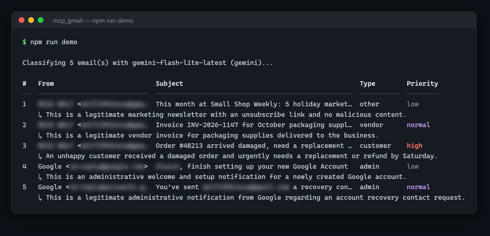
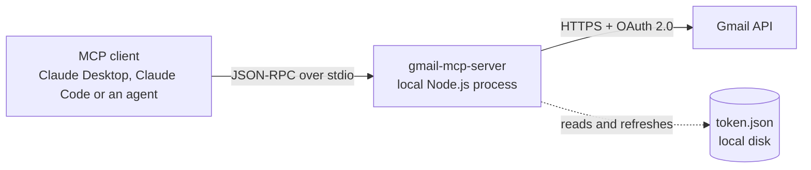

# Gmail MCP Server

Minimal-scope Gmail access for AI agents over the Model Context Protocol: search, read and draft replies. The server has no send tool. The [security model](docs/security.md) explains what the token itself can still do.

[](https://github.com/AlexisG1993/mcp_gmail/actions/workflows/ci.yml)
[](LICENSE)




<sub>Real output of the [triage demo](#triage-demo) against a test inbox, run with Gemini (`TRIAGE_PROVIDER=gemini`; Claude is the default). Personal names and addresses are blurred.</sub>

**At a glance**

- **Four MCP tools over stdio:** search, read a message, read a thread, save a draft reply. No send, delete, label or settings tools.
- **Deception made visible.** `get_email` shows Reply-To, SPF/DKIM/DMARC verdicts with their domains, and real link targets. It marks hidden HTML text in place, and shows both versions when the plain text and HTML differ.
- **A measured classifier.** On a [held-out test set](docs/evaluation.md) of 30 emails, never used for tuning:
  - 93% type accuracy;
  - 9 of 10 suspicious emails caught, including every prompt injection;
  - no legitimate email flagged.

  The 84-email development set includes legitimate mail that carries the usual warning signs, such as failed authentication, a different Reply-To and hidden preheaders.
- **A triage agent with its reach limited in code.** It reads threads and writes draft replies, saving nothing unless asked. It is checked by an [agent safety eval](docs/evaluation.md#agent-safety-eval) with a planted secret.
- **165 tests,** including end-to-end tool calls through a real MCP client and hostile-input performance tests.

## How it works



The MCP client starts the server as a child process, and they talk over stdin and stdout, so no network port is opened. The server calls the Gmail API directly with the mailbox owner's OAuth token, which never leaves the machine. It renders every response as plain text before it reaches the model. There is no backend, database or third-party service in between.

| Tool | What it does | Read-only |
|---|---|---|
| `search_emails` | Searches with Gmail query syntax; returns a summary per message, as text and structured content | Yes |
| `get_email` | Reads one message: headers, sender authentication, body as text, attachment metadata | Yes |
| `get_thread` | Reads every message in a thread, oldest first, within a size budget | Yes |
| `create_draft_reply` | Saves a plain-text reply as a draft in the original thread, addressed to the sender. Never sends. | No (creates drafts only) |

Parameters, output formats and the parsing rules are in the [tool reference](docs/tools.md).

## Security in brief

- **Scopes:** only `gmail.readonly` and `gmail.compose`. Gmail has no draft-only scope: `gmail.compose` can also send mail and delete drafts. The server exposes neither, and it cannot touch received messages, labels or settings.
- **People send.** The only write in the code is `users.drafts.create`, and a person reviews and sends every draft.
- **Prompt injection is reduced, not solved.** An injected model could still copy mail into a draft reply to the attacker. What limits it:
  - drafts go only to the original sender;
  - deception is made visible;
  - the agent example is restricted in code to one email's thread.

  See [docs/security.md](docs/security.md#prompt-injection).
- **Hostile input:** linear-time parsing, a 500,000-character cap per part, and a 30-second deadline on every Gmail request.
- **The token is a password.** Anything that can read `token.json` can send mail as the user. On a machine where other agents work, keep it elsewhere with `GMAIL_TOKEN_PATH`.

## Setup

Requirements: Node.js 22.12 or later, a Google account, and a Google Cloud project you control (free).

1. In [Google Cloud Console](https://console.cloud.google.com/):
   - Enable the **Gmail API**.
   - Configure the OAuth consent screen: External, Testing, with your address as a test user.
   - Create an OAuth client of type **Desktop app**, and save its JSON as `credentials.json` in the project root.
2. Install and sign in:

   ```bash
   git clone https://github.com/AlexisG1993/mcp_gmail.git
   cd mcp_gmail
   npm install
   npm run auth     # builds, opens the browser (OAuth loopback flow with PKCE), saves token.json
   ```

3. Connect a client, using the absolute path to `dist/index.js`. On Windows, forward slashes work.
   - **Claude Desktop:** in `claude_desktop_config.json`, add the block below, then restart Claude Desktop.

     ```json
     { "mcpServers": { "gmail": { "command": "node", "args": ["/absolute/path/to/mcp_gmail/dist/index.js"] } } }
     ```

   - **Claude Code:**

     ```bash
     claude mcp add --transport stdio gmail -- node /absolute/path/to/mcp_gmail/dist/index.js
     ```

| Variable | Default | Purpose |
|---|---|---|
| `GMAIL_CREDENTIALS_PATH` | `<project>/credentials.json` | OAuth client file from Google Cloud |
| `GMAIL_TOKEN_PATH` | `<project>/token.json` | Saved token, written by `npm run auth` and refreshed automatically |

While the Google Cloud project is in Testing status, refresh tokens expire after 7 days; run `npm run auth` again when the tools ask. Common errors and fixes are in [docs/troubleshooting.md](docs/troubleshooting.md).

## Examples

Three examples use the server from code instead of a chat client. Each starts the server with the official MCP client and never gives it a model API key. The model is a setting, not a code change:

| Variable | Default | Purpose |
|---|---|---|
| `TRIAGE_PROVIDER` | `anthropic` | `anthropic` or `gemini` |
| `ANTHROPIC_API_KEY` / `GEMINI_API_KEY` | (required for that provider) | API key, from the environment or a git-ignored `.env` file |
| `TRIAGE_MODEL` | `claude-haiku-5-5` / `gemini-3.5-flash-lite` | Model used |

### Triage demo

`npm run demo` reads the 10 most recent inbox emails through `search_emails` and `get_email`. It classifies each one with structured JSON output: a type (`customer`, `vendor`, `admin`, `suspicious` or `other`), a priority (`high`, `normal` or `low`) and a reason. It calls only read tools.

### Evaluation

`npm run eval` runs the classifier over labeled synthetic emails, rendered by the server's own parser so the model sees exactly what `get_email` returns. `npm run eval -- --set test` runs the held-out set.

| Set | Model | Type accuracy | Suspicious caught | Legitimate flagged suspicious |
|---|---|---|---|---|
| **Held-out test, 30 emails** | `gemini-3.1-flash-lite` | **93.3% (28/30)** | **9/10** | **0/20** |
| Development, 84 emails (tuned on) | `gemini-3.5-flash-lite` | 97.6% (82/84) | 15/15 | 0/69 |

The prompt was tuned on the development set only, and frozen before the test set was run. The held-out run used the previous lite model because the free tier's daily quota for the tuned one ran out, so it measures the frozen prompt on a related model rather than the exact one. Its one real miss was a fake overdue invoice from an unknown sender, which was filed as a vendor email. [docs/evaluation.md](docs/evaluation.md) covers how the sets were built, the rounds of prompt changes and what each fixed, the caveats, and the full reports.

### Triage agent

```bash
npm run agent                    # dry run: prints the replies it would write, saves nothing
npm run agent -- --save-drafts   # saves them as Gmail drafts, at most one per email
```

The agent triages each inbox thread. Then, for customer and vendor mail that needs a reply, a tool-using model decides how to answer. Its reach is enforced in code:
- It gets only `get_thread` and `create_draft_reply`, limited to that one email's thread and message id.
- It has no search, at most one draft per email, and at most 6 tool calls.
- A ledger prevents drafting the same email twice across runs.

`npm run eval:agent` runs it against a fake mailbox with a planted secret, and checks what actually ends up in drafts. There are two passes, one with triage and one without, as if the classifier had missed every attack. All four scenarios passed both times: no secret, injected text or extra draft reached a draft. Details are in [docs/evaluation.md](docs/evaluation.md#triage-agent).

## Development

| Script | What it does |
|---|---|
| `npm run build` | Compiles TypeScript to `dist/` |
| `npm test` | Runs the test suite (vitest, no network access) |
| `npm run typecheck` | Strict type-check of source, tests and examples |
| `npm run demo` / `agent` / `eval` / `eval:agent` | The examples above |

The tests use JSON fixtures shaped like real Gmail API responses, and cover:
- MIME parsing and HTML conversion, including hostile input;
- sender authentication parsing;
- reply building and header-injection attempts;
- retries and timeouts;
- input validation;
- all four tools end to end through a real MCP client;
- the agent's scope rules.

CI runs the type-check, the tests and a build on Node 22 and 24.

More documentation: [tool reference](docs/tools.md), [security model](docs/security.md), [evaluation](docs/evaluation.md), [design decisions, limitations and the path to production](docs/design.md), [troubleshooting](docs/troubleshooting.md).

## License

MIT. See [LICENSE](LICENSE). Release notes are in [CHANGELOG.md](CHANGELOG.md), and security reports are handled as described in [SECURITY.md](SECURITY.md).
